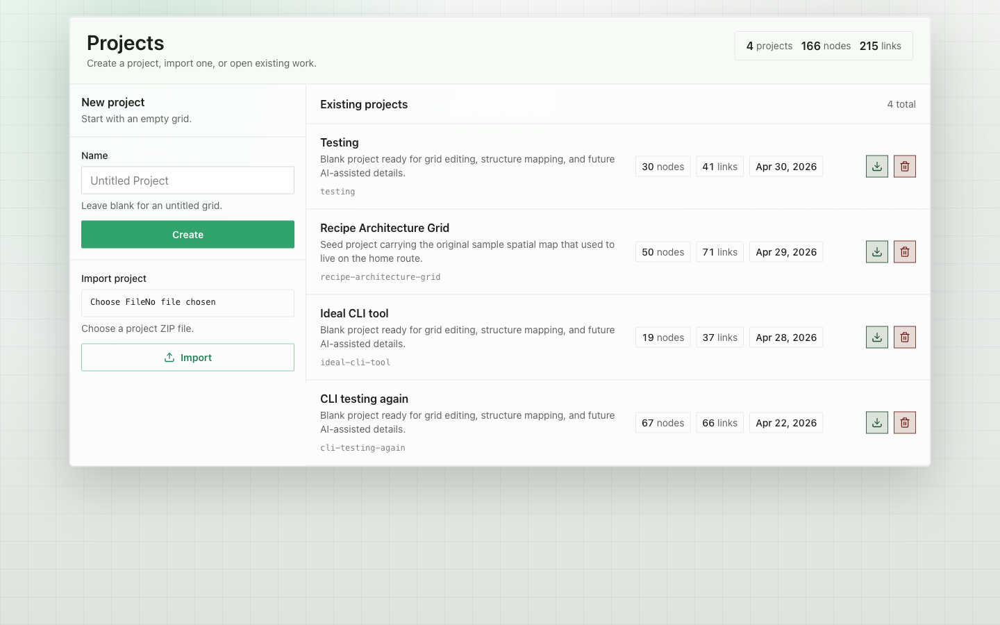
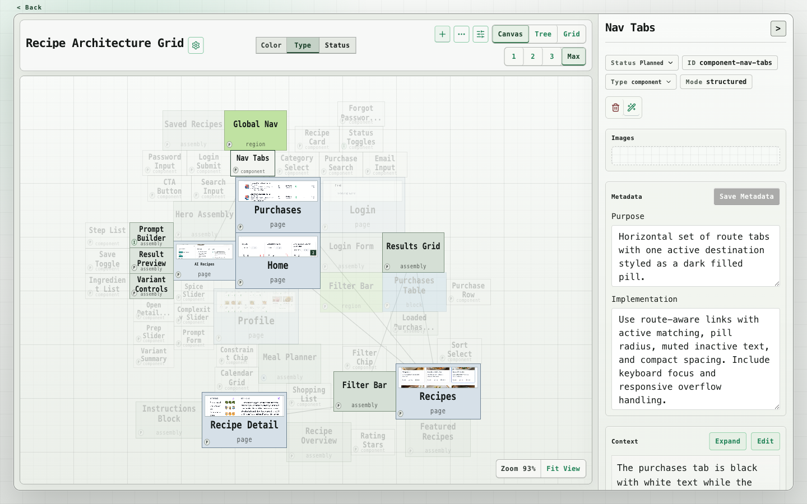
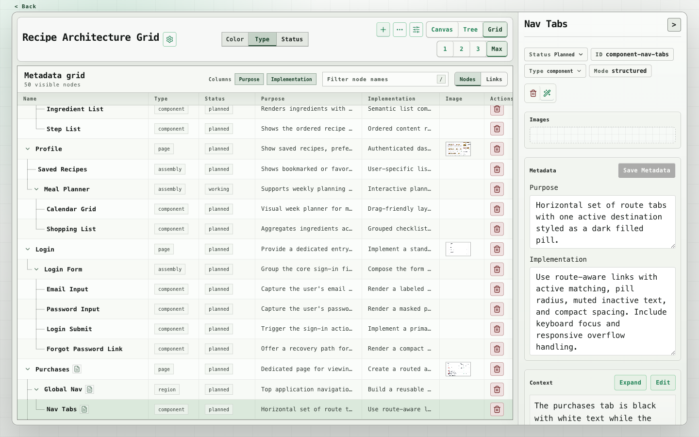
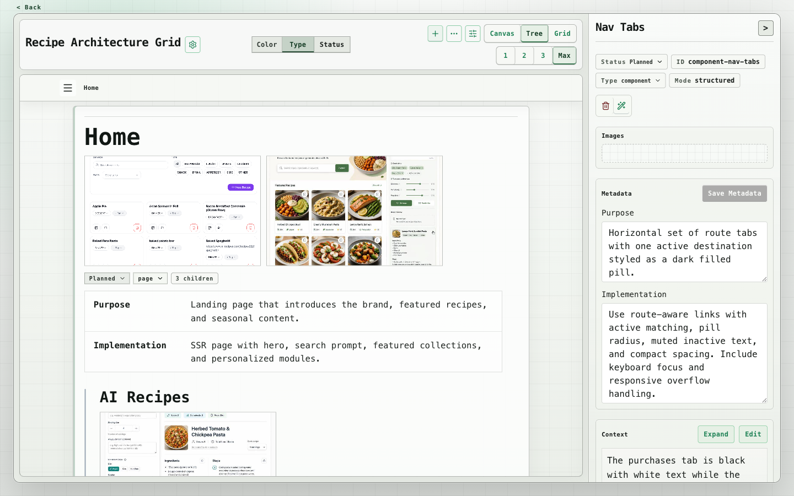
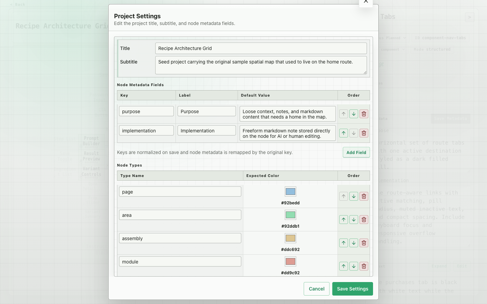
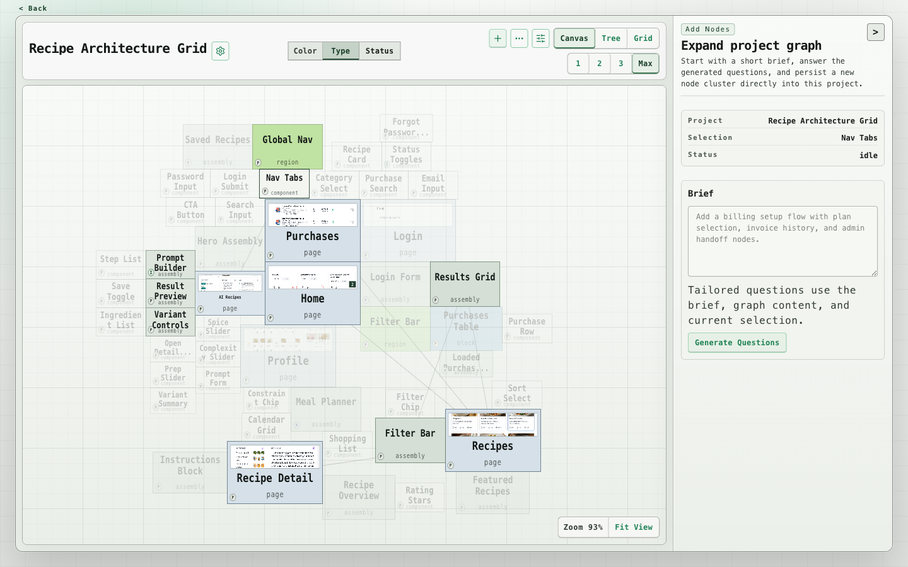
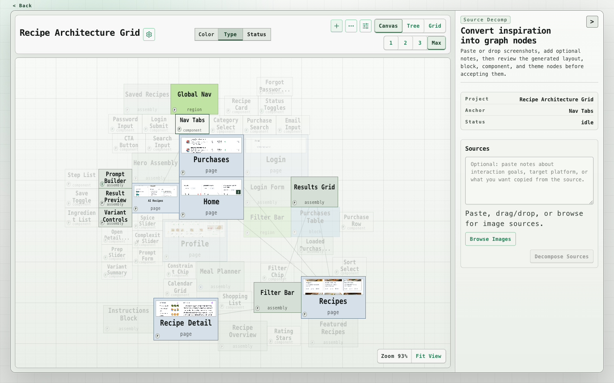
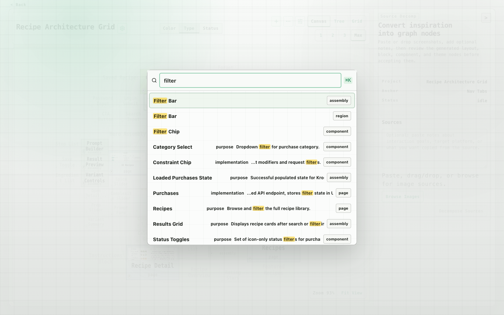

# Product Grid Management

Product Grid Management is a SolidStart application for mapping product ideas, UI architecture, system relationships, and loose planning context as a spatial graph. It combines a project registry, an interactive map canvas, structured node metadata, markdown context notes, image attachments, and AI-assisted workflows for expanding or converting project knowledge.

## Screenshots

The current app supports several complementary working modes:

















## App Features

### Project Registry

- Create blank project workspaces from the landing page.
- Import project ZIP archives from the landing page.
- Export project ZIP archives from each project row.
- View a registry of existing projects with project counts, node counts, and link counts.
- Open any project directly into its grid workspace.
- Delete projects from the registry.
- Persist project records to local JSON data under `app/data/projects.json`.
- Store project metadata including id, name, description, created timestamp, updated timestamp, nodes, and links.
- Track project-level metadata schema and node type schema alongside graph data.

### Spatial Product Map

- Render each project as an interactive spatial map of typed rectangular nodes.
- Represent product structure with parent-child hierarchy links.
- Represent non-hierarchical relationships with related, dependency, and reuse links.
- Use spatial proximity and clustering as the primary relationship signal.
- Keep edges hidden by default to reduce graph noise.
- Toggle relationship edges on when explicit link tracing is useful.
- Size nodes by hierarchy depth so larger concepts and smaller implementation details read differently.
- Style nodes by type with deterministic fallback color tones.
- Switch node coloring between type colors and status colors.
- Show node labels and type metadata directly on the canvas.
- Wrap long node labels inside SVG nodes for scan-friendly rendering.
- Display image previews inside nodes when attachments exist.
- Show selected-node inspector state alongside the canvas.

### Canvas Navigation

- Pan the map by dragging the viewport.
- Zoom with the mouse wheel around the pointer position.
- Fit the camera to all visible nodes from the toolbar.
- Use the `F` keyboard shortcut to fit the current view.
- Reflow the layout to regenerate the visible node arrangement.
- Preserve viewport behavior across resize events.
- Animate layout and camera transitions when depth filters, isolation, or data changes.
- Clear selection by clicking the background.
- Open a command palette with `Cmd/Ctrl+K` to search nodes by title, id, type, status, metadata, context, or raw context.
- Isolate the selected command-palette result on the canvas.

### Focus and Isolation

- Select a node to make it the active item in the inspector.
- Hover nodes to highlight the active/related neighborhood.
- Double-click a node to isolate that node's local hierarchy.
- Toggle linked nodes into an isolated view with "Show Linked".
- Clear isolation and return to the broader project map.
- Dim or de-emphasize unrelated nodes and edges during focus states.

### Depth and View Controls

- Switch between canvas, tree/document, and metadata grid views.
- Filter the map by visible hierarchy depth from the toolbar.
- Automatically clamp available depth controls to the current visible graph.
- Keep depth filtering compatible with isolation mode.
- Show project title, description, and back navigation in the project toolbar.
- Copy the currently visible nodes as markdown from the toolbar action menu.

### Hierarchy Tree View

- Inspect the same project graph as a structured tree.
- Build the tree from parent-child links.
- Show root nodes, nested children, node purpose, type, depth, and child counts.
- Select nodes from the tree and synchronize the selection with the inspector.
- Display image thumbnails in tree rows.
- Support image drag-and-drop on tree rows.
- Provide a reading-oriented tree/document view with breadcrumb-style navigation, large node previews, metadata summaries, and section anchors.

### Metadata Grid View

- Review visible nodes in a dense table built from the same filtered graph.
- Preserve hierarchy indentation, expand/collapse controls, and selected-node highlighting.
- Toggle project metadata columns on and off.
- Filter node rows by name with a search field and `/` shortcut.
- Inspect non-hierarchy links in a separate grid mode.
- Delete nodes or non-hierarchy links directly from the grid.
- Display node image thumbnails and document/context indicators in grid rows.

### Inspector Rail

- Inspect selected node metadata including id, type, context mode, and depth.
- Read node purpose and implementation notes.
- Edit selected-node title in place.
- Change node status and node type from inspector menus.
- View incoming and outgoing relationships grouped separately.
- Click related nodes from the connection lists to jump selection.
- Collapse and reopen the inspector rail.
- Delete selected nodes and automatically remove their links.
- Generate mockup images for the selected node from the inspector.
- Open context-only note conversion from eligible nodes.

### Project Settings

- Edit project name and description in a modal settings dialog.
- Define project-specific metadata fields with keys, labels, default values, and ordering.
- Add, remove, and reorder metadata fields.
- Define project-specific node types.
- Pick and reorder expected colors for each node type.
- Remap node metadata safely when schema keys change.

### Markdown Context

- Store freeform markdown context on any node.
- Edit node context from the inspector with a form-backed server action.
- Preview context as rendered markdown when not editing.
- Expand longer context into a dialog.
- Render context-only notes as raw text until they are converted.
- Copy raw context from context-only nodes.
- Keep raw source context alongside structured context for AI conversion workflows.

### Context Nodes

- Create standalone context note nodes from the toolbar.
- Add a label and freeform markdown content.
- Store context nodes as `note` nodes with `context-only` mode.
- Optionally split markdown by heading level during import.
- Convert headings into linked child note nodes.
- Choose the maximum heading depth to promote into child nodes.
- Preserve deeper markdown under the parent context when not promoted.

### Image Attachments

- Attach image files to nodes by dropping images onto canvas nodes.
- Attach image files by dropping onto inspector image panels.
- Attach image files by dropping onto tree rows.
- Paste images from the clipboard while a node is selected.
- Store image files on disk under `app/data/images/<project>/<node>/`.
- Support AVIF, GIF, JPEG, PNG, and WebP image uploads.
- Display thumbnails in canvas nodes, inspector panels, and tree rows.
- Open images in a dedicated viewer dialog.
- Zoom images in the viewer with the wheel.
- Pan images in the viewer by dragging.
- Reset image viewer zoom/pan with double-click or the Reset button.
- Show image metadata including MIME type, size, and zoom level.

### AI-Generated Mockups

- Generate a low-cost PNG mockup image for any selected node.
- Capture selected node metadata plus child and descendant context before planning the image.
- Ask the text model to plan the mockup title, prompt, dimensions, and rationale.
- Generate the image through the server-only OpenAI image pipeline.
- Attach the generated PNG back to the selected node automatically.
- Track run progress through capture, prompt planning, image generation, and persistence steps.
- Log LLM sessions and pipeline events for inspection and debugging.

### AI-Assisted Node Expansion

- Start an "Add Nodes" flow from any project.
- Provide a short brief describing the new product area, workflow, or system detail.
- Include the current project graph and current node selection as generation context.
- Generate 3-4 clarifying questions before adding nodes.
- Answer questions through guided multiple-choice options.
- Generate a structured batch of new nodes and links.
- Add up to 10 generated nodes per run.
- Persist generated nodes into the current project.
- Deduplicate generated link keys when merging results.
- Generate follow-up suggestions after nodes are added.
- Restart the flow from a suggested follow-up brief.
- Track run progress with explicit steps: capture context, generate questions, await answers, generate nodes, persist graph, suggest follow-ups, and complete.

### Source Decomposition

- Start a "Decompose Source" flow from the create menu.
- Paste or type source notes into the rail.
- Paste, drag/drop, or browse for source images.
- Preview source images before running decomposition.
- Anchor decomposition to the currently selected node when available.
- Generate a candidate tree of layout, block, component, and theme nodes from source material.
- Review generated candidates before committing them to the project.
- Select or deselect individual candidates and whole candidate subtrees.
- Persist accepted candidates and links back into the graph.
- Open the first accepted node after persistence.
- Track run progress over SSE while decomposition is active.

### Context Note Conversion

- Convert context-only note nodes into structured product map nodes.
- Generate clarifying questions before producing conversion candidates.
- Produce a candidate hierarchy of structured nodes and links from loose context.
- Review suggested candidates before committing them.
- Select or deselect individual candidate nodes.
- Toggle candidate subtrees as a group.
- Accept only the selected nodes and links.
- Trim the original note context after accepted structured nodes are created.
- Track run progress with explicit conversion steps: capture context, generate questions, await answers, generate suggestions, await selection, persist graph, trim context, and complete.

### AI SDK Integration

- Uses the Vercel AI SDK with `@ai-sdk/openai`.
- Keeps OpenAI calls in server-side service modules.
- Reads `OPENAI_API_KEY` from the environment.
- Defaults lightweight work to `OPENAI_MODEL`, with `gpt-5-mini` documented in `app/.env.example`.
- Uses `OPENAI_HEAVY_MODEL` for heavier reasoning, with `gpt-5.4` documented in `app/.env.example`.
- Uses structured `zod` schemas for generated questions, node batches, candidate batches, source decomposition output, image prompt plans, trim results, and follow-up suggestions.
- Uses `generateText()` with structured object output for new AI service code.
- Provides server-sent event endpoints for long-running AI workflow progress.
- Includes LLM logging utilities for pipeline sessions and run events.

### Data Model

- Projects contain a `SpatialMapData` graph with `nodes` and `links`.
- Nodes include id, label, type, depth, purpose, implementation, context, raw context, context mode, and optional images.
- Nodes include status values for planning/work tracking.
- Projects include metadata field definitions and node type definitions.
- Links support parent-child relationships and lateral relationships.
- Lateral relationships can be `related`, `dependency`, or `reuse`.
- Generated node batches are merged with stable project-specific ids.
- Node ids are derived from type and label and made unique with numeric suffixes.
- Project ids are slugged from project names and made unique with numeric suffixes.
- Data loading validates spatial map records before they reach the UI.

### Agent API and CLI

- Provides `/api/v1` endpoints for agent-oriented project, node, task, import, export, metadata, context, image, and move operations.
- Supports token-based API scopes for read and write access.
- Allows local development read access when token auth is not configured outside production.
- Ships a `pgm` CLI under `packages/cli/`.
- Lists, creates, links, views, and exports projects from the CLI.
- Lists, searches, filters, creates, updates, moves, and imports nodes from the CLI.
- Sets node context and metadata from CLI commands.
- Adds, lists, and removes node images from the CLI.
- Exports project context as LLM-ready markdown.
- Includes a bundled `product-grid-context` Codex skill installer through `pgm skill`.
- Shares typed API contracts through `packages/api-contract/`.

### Live and Debug Tooling

- Includes a lightweight jobs websocket endpoint for connection status and future live job updates.
- Includes a console log capture module for in-app debugging, filtering, and review.
- Includes global error overlay UI.
- Includes a component explorer module for design system and recipe inspection.

### Markdown Renderer

- Provides a reusable markdown rendering module in `app/src/components/markdown-renderer/`.
- Supports GitHub-flavored markdown.
- Supports syntax-highlighted code blocks.
- Supports line-numbered code rendering.
- Supports markdown tables.
- Supports Mermaid diagram blocks.
- Includes Mermaid viewport and dialog helpers for larger diagrams.

### Developer and Design System Features

- Built with SolidStart, SolidJS, and the Solid router.
- Uses Panda CSS for theme tokens, recipes, layer styles, text styles, keyframes, and generated styles.
- Uses Park UI / Ark UI wrapper components under `app/src/components/ui/`.
- Includes reusable app wrappers such as `SimpleDialog`, `SimplePopover`, `SimpleSelect`, `PanelPopover`, and `ConfirmDialog`.
- Provides Vitest tests for spatial layout, spatial relations, add-node validation, run registries, context-note conversion, source decomposition, LLM logging, archive behavior, API auth, and project data operations.
- Includes patched dependencies for Vinxi and Panda generator behavior.

## Quick Start

Run commands from `app/`:

```bash
pnpm install
pnpm prepare
pnpm dev
```

For AI-assisted features, create an environment file from `app/.env.example` and provide `OPENAI_API_KEY`.

## Common Commands

```bash
pnpm lint
pnpm lint:fix
pnpm type-check
pnpm test
pnpm build
pnpm start
```

## Key Paths

- App workspace: `app/`
- App entry: `app/src/app.tsx`
- Project registry page: `app/src/components/projects/ProjectIndexPage.tsx`
- Project detail page: `app/src/components/projects/ProjectDetailPage.tsx`
- Spatial map module: `app/src/components/spatial-map/`
- Project data services: `app/src/lib/projects/`
- Add-nodes AI workflow: `app/src/lib/add-nodes/`
- Context-note conversion workflow: `app/src/lib/context-note-conversion/`
- Source decomposition workflow: `app/src/lib/source-decomposition/`
- Node image generation workflow: `app/src/lib/node-images/`
- Agent API services: `app/src/lib/agent-api/`
- CLI package: `packages/cli/`
- Shared API contract package: `packages/api-contract/`
- Screenshot set used by this README: `docs/readme-screenshots/`
- Markdown renderer: `app/src/components/markdown-renderer/`
- Shared UI wrappers: `app/src/components/ui/`
- Theme and recipes: `app/src/theme/`
- Local project data: `app/data/`
- Design brief: `docs/design-brief-industrial-ui.md`

## Notes

- `app/styled-system/` is generated by Panda and should not be edited by hand.
- The root README describes current repository capabilities; `app/README.md` contains app-workspace setup notes.
