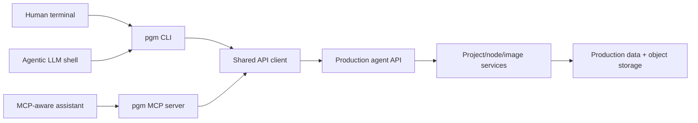

# Agentic LLM Interface Plan

> Historical review. In-app AI workflows and their routes have been removed.
> CLI APIs, project events, and image attachments remain.

## Summary

Build a first-party CLI as the primary interface for agentic LLMs and power users. The CLI should behave like a focused mix of `gh` and Railway: login once, select or link a project, run predictable resource commands, emit machine-readable JSON when requested, and provide a few higher-level commands that agents can call safely.

MCP should be treated as a second adapter over the same HTTP API, not as the source of truth. The CLI is the better first product because it is easy for humans to inspect, easy for coding agents to call from a shell, easy to run in CI, and easier to secure with scoped tokens and explicit write commands. MCP becomes valuable later for native assistant integrations, but it should reuse the same auth model, API schemas, and permission boundaries.

Recommended shape:

1. Add a versioned agent API on the production server.
2. Build a standalone CLI package that talks only to that API.
3. Use OAuth device login or browser login for users, with scoped API tokens stored locally.
4. Make every command support `--json`, stable exit codes, and non-interactive flags.
5. Add an MCP server later as a thin wrapper around the CLI client library or the same generated API client.

## Goals

- Let agentic LLMs query project data without scraping the UI.
- Let users and agents list projects, nodes, task lists, node images, and project context from the terminal.
- Let agents make safe, auditable writes to nodes, links, task state, metadata, context, and images.
- Support higher-level workflows such as "show blocked nodes", "attach this image to node X", "generate mockups for these nodes", and "create child tasks from this brief".
- Model the ergonomics after `gh` and Railway: short commands, project linking, sensible defaults, JSON output, and explicit auth.
- Keep the web app and CLI backed by the same server-side business rules.
- Make it possible to expose the same capabilities through MCP later without designing two different integration surfaces.

## Non-Goals

- Do not let the CLI write directly to production storage.
- Do not make the CLI depend on local app internals, generated Panda files, or filesystem project records.
- Do not make MCP the only integration path.
- Do not require a local web app session or browser automation for agent access.
- Do not expose raw database records as the public contract.
- Do not give agents unbounded "execute arbitrary mutation" endpoints.

## Recommendation

Choose the CLI-first path.

The CLI should be the primary interface because agentic coding systems can already run shell commands, inspect stdout, pass files, and reason about exit codes. This makes a CLI a low-friction interface for both humans and LLM agents. A well-designed CLI also doubles as documentation for the API surface.

MCP is still useful, but it is better as an adapter:

- MCP tools are excellent inside MCP-aware assistant clients.
- MCP resources can expose project context nicely.
- MCP prompts can guide common workflows.
- MCP is less universal than a CLI and has more host-specific operational differences.

The durable architecture is:



## CLI Product Model

Use a short binary name such as `pgm`, `grid`, or `product-grid`. The examples below use `pgm`.

### Command Principles

- Commands are resource-oriented: `project`, `node`, `task`, `image`, `run`, `auth`, `config`.
- Read commands default to human tables.
- Every read command supports `--json`.
- Write commands require explicit resource IDs unless the current project is linked.
- Destructive writes require `--confirm` or interactive confirmation.
- Long-running AI jobs return a run ID and support `--watch`.
- All commands have stable non-interactive forms.
- All commands support `--project <id>` and fall back to the linked project.
- Output is quiet by default and scriptable with `--json`.

### Global Flags

```bash
pgm --help
pgm --version
pgm --project <project-id> ...
pgm --server https://app.example.com ...
pgm --json ...
pgm --jq '.nodes[] | select(.status == "blocked")' ...
pgm --quiet ...
```

The optional `--jq` pattern is copied from `gh`: when JSON output is available, users can filter in one step without piping through a separate tool.

### Auth Commands

```bash
pgm auth login
pgm auth login --server https://app.example.com
pgm auth status
pgm auth token
pgm auth logout
```

Recommended auth flow:

1. CLI starts an OAuth device flow or opens browser login.
2. Production server issues a short-lived access token and long-lived refresh token.
3. CLI stores credentials in the OS keychain when available.
4. Tokens are scoped by capabilities such as `project:read`, `node:write`, `image:write`, and `run:start`.
5. Service tokens can be created in the web UI for CI or autonomous workers.

For early prototypes, a personal access token is acceptable:

```bash
pgm auth login --token <token>
```

Do not make long-lived admin cookies the CLI auth mechanism. Cookies are too easy to over-scope and too tied to browser session behavior.

### Project Commands

```bash
pgm project list
pgm project create "Product Site"
pgm project create "Product Site" --link --json
pgm project view <project-id>
pgm project link <project-id>
pgm project unlink
pgm project current
pgm project export-markdown --output project-context.md
pgm project export <project-id> --output project.zip
```

Expected behavior:

- `project list` maps to the existing project summaries concept.
- `project create` creates a blank project and returns the created project ID/name for immediate agent use.
- `project view` returns the full project record or a public API projection.
- `project link` writes a local config file, similar to Railway linking a local folder to a project.
- `project export-markdown` returns an LLM-ready markdown projection of the project graph.
- `project export` maps to the existing archive export route.

Example agent call:

```bash
pgm project list --json
```

### Node Commands

```bash
pgm node list
pgm node view <node-id>
pgm node search "checkout flow"
pgm node create --title "Checkout review" --type page --parent <parent-node-id>
pgm node update <node-id> --title "Checkout review" --status needs-review
pgm node update <node-id> --type feature
pgm node context get <node-id>
pgm node context set <node-id> --file ./context.md
pgm node metadata set <node-id> owner "Design"
pgm node metadata unset <node-id> owner
pgm node move <node-id> --parent <parent-node-id>
pgm node delete <node-id> --confirm
```

The current CLI/API supports create, title/status/type update, context set/get, metadata set/unset, and move/reparent operations through server-side project services. Delete remains a future safety-gated command.

Suggested read filters:

```bash
pgm node list --status blocked
pgm node list --type feature
pgm node list --parent <node-id>
pgm node list --orphans
pgm node list --updated-since 2026-04-01
```

Suggested JSON projection:

```json
{
  "id": "checkout-review",
  "label": "Checkout review",
  "type": "feature",
  "status": "needs-review",
  "metadata": {
    "owner": "Design"
  },
  "context": "...",
  "images": []
}
```

### Task Commands

Tasks can initially be represented as filtered node views. If the app later adds a first-class task model, the CLI command can keep the same shape and change the API behind it.

```bash
pgm task list
pgm task list --status blocked
pgm task next
pgm task view <node-id>
pgm task done <node-id>
pgm task block <node-id> --reason "Waiting on image assets"
pgm task review <node-id>
```

Initial mapping:

- `planned` means backlog.
- `working` means active work.
- `blocked` means blocked task.
- `needs-review` means review queue.
- `implemented` means done.
- `deprecated` means hidden or closed.

This gives agents a stable task interface without requiring a new data model immediately.

### Image Commands

```bash
pgm image list <node-id>
pgm image add <node-id> ./mockup.png
pgm image add <node-id> ./a.png ./b.jpg
pgm image remove <node-id> <image-id>
pgm image generate <node-id> --prompt "Mobile checkout confirmation screen"
pgm image generate <node-id> --size 1536x1024 --watch
pgm image open <node-id> <image-id>
```

The app already has image storage and a node image generation route. The CLI supports multipart upload, list, and remove for node images; generation remains a future run-backed command.

For agent workflows, `image add` is more important than `image open`. Agents can generate or receive image files locally, then attach them to the relevant node with an explicit command.

### AI Run Commands

Use `run` for long-running operations that produce events.

```bash
pgm run list
pgm run view <run-id>
pgm run watch <run-id>
pgm run cancel <run-id>
```

Domain-specific shortcuts can start runs:

```bash
pgm node add-from-brief --parent <node-id> --file ./brief.md --watch
pgm image generate <node-id> --watch
pgm source decompose --node <node-id> --file ./prd.md --watch
```

Long-running commands should print:

- The run ID.
- Current status.
- A stable event stream when `--watch` is used.
- A final JSON summary when `--json` is used.

### Query Commands

Agents often need compact context, not entire project dumps. Add query commands that return purpose-built views.

```bash
pgm query project-summary
pgm query node-context <node-id> --depth 2
pgm query related <node-id>
pgm query blockers
pgm query open-work
pgm query stale --days 14
```

These commands should be backed by explicit API endpoints or client-side transformations over stable read endpoints. Avoid adding a generic unrestricted query language until the permission model is mature.

## Production API Design

Add versioned routes under an agent/API namespace:

```text
/api/v1/projects
/api/v1/projects/:projectId
/api/v1/projects/:projectId/export
/api/v1/projects/:projectId/nodes
/api/v1/projects/:projectId/nodes/:nodeId
/api/v1/projects/:projectId/nodes/:nodeId/context
/api/v1/projects/:projectId/nodes/:nodeId/metadata
/api/v1/projects/:projectId/nodes/:nodeId/images
/api/v1/projects/:projectId/nodes/:nodeId/images/:imageId
/api/v1/projects/:projectId/runs
/api/v1/projects/:projectId/runs/:runId
/api/v1/projects/:projectId/runs/:runId/events
/api/v1/projects/:projectId/queries/:queryName
```

Keep route handlers thin. They should validate auth, validate input, call existing server-side services, and return typed JSON. The app already has useful server functions in the project data layer; production API handlers should reuse those rather than duplicating mutation logic.

### API Conventions

- Use JSON for normal reads and writes.
- Use multipart upload for image files.
- Use Server-Sent Events for watchable runs.
- Use typed error responses with `code`, `message`, and optional `details`.
- Return resource versions or `updatedAt` timestamps from writes.
- Accept idempotency keys for create operations and AI job starts.
- Make all list endpoints pageable, even if the first implementation returns everything.

Example error:

```json
{
  "error": {
    "code": "node_not_found",
    "message": "Node not found.",
    "details": {
      "nodeId": "checkout-review"
    }
  }
}
```

### Schema Ownership

Use shared Zod schemas close to the server modules that own the contract. Generate or export TypeScript types for the CLI client from those schemas. This avoids having the CLI drift from the app's actual node, image, project, and run shapes.

Recommended packages:

```text
packages/api-contract
packages/cli
packages/mcp-server
```

If this remains a single app workspace initially, put the CLI under `app/packages/cli` or a top-level `packages/cli`, but keep it separate from Solid UI code.

## Auth and Authorization

### Token Types

Support two token modes:

- User tokens from browser/device login.
- Service tokens created explicitly for agents, CI, or automations.

Service tokens should be scoped and revocable:

```text
project:read
project:export
node:read
node:write
image:read
image:write
run:start
run:read
```

Optionally scope tokens to specific projects:

```text
project_id=checkout-redesign
scopes=node:read,node:write,image:write
```

### Write Safety

Agent-facing writes should be narrow:

- `node.updateTitle`
- `node.updateStatus`
- `node.updateType`
- `node.updateContext`
- `node.setMetadata`
- `node.addImage`
- `node.deleteImage`
- `node.move`
- `node.createChild`
- `run.startAddNodes`
- `run.startImageGeneration`

Avoid a generic "replace project JSON" endpoint. It is hard to audit and easy for an agent to misuse.

### Audit Log

Every write from the CLI or MCP server should record:

- Actor user or service token ID.
- Client type, such as `cli` or `mcp`.
- Command or API operation.
- Project ID and resource ID.
- Before/after summary for node fields.
- Request ID and idempotency key.
- Timestamp.

Add `pgm audit list` later if audit review becomes a core workflow.

## MCP Server Plan

Build MCP after the CLI and API contract are stable.

MCP server modes:

```bash
pgm mcp serve
```

or a separate binary:

```bash
pgm-mcp
```

Expose read-heavy resources:

```text
product-grid://projects
product-grid://projects/:projectId
product-grid://projects/:projectId/nodes
product-grid://projects/:projectId/nodes/:nodeId
product-grid://projects/:projectId/tasks/open
product-grid://projects/:projectId/tasks/blocked
```

Expose tools that match CLI/API operations:

```text
project_list
project_view
node_list
node_view
node_update
node_context_set
node_metadata_set
node_image_add
node_image_generate
task_list
task_update_status
run_watch
```

The MCP server should not invent different names, permission rules, or payload shapes. If the CLI command is `pgm node update`, the MCP tool should call the same client method as that command.

## CLI UX Examples

### Agent Gets Current Work

```bash
pgm project link checkout-redesign
pgm task list --status blocked --json
pgm task next --json
```

### Agent Updates a Node

```bash
pgm node update checkout-review --status working --json
pgm node context set checkout-review --file ./notes.md --json
pgm node update checkout-review --status needs-review --json
```

### Agent Attaches Images

```bash
pgm image add checkout-review ./checkout-mobile.png ./checkout-desktop.png --json
pgm image list checkout-review --json
```

### Agent Starts a Generated Node Run

```bash
pgm node add-from-brief --parent checkout-review --file ./brief.md --watch --json
```

### Human Uses Tables

```bash
pgm node list --status blocked
```

Possible output:

```text
ID                    STATUS    TYPE      TITLE
checkout-review       blocked   feature   Checkout review
receipt-empty-state   blocked   screen    Receipt empty state
```

## Implementation Roadmap

### Phase 1: Contract and Read-Only CLI

- Create `/api/v1` read endpoints for projects, project detail, node list, node view, and task list.
- Add token auth middleware.
- Create a CLI package with `auth`, `project list`, `project view`, `project link`, `node list`, `node view`, and `task list`.
- Add `--json` output and stable error handling.
- Add local config for linked project and server URL.

This phase gives agents useful query access without write risk.

### Phase 2: Safe Node Writes

- Add node update endpoints for title, status, type, context, and metadata.
- Add CLI commands for `node update`, `node context set`, and `node metadata set`.
- Add audit logging.
- Add idempotency keys for write commands.
- Add service tokens scoped to project and operation.

This phase enables task completion loops.

### Phase 3: Images and Runs

- Add image upload/list/delete endpoints.
- Add CLI `image add`, `image list`, and `image remove`.
- Expose run start/watch endpoints for add-nodes and image generation.
- Add `--watch` support for SSE.
- Add `run list`, `run view`, and `run watch`.

This phase supports richer agent workflows involving generated or uploaded visual artifacts.

### Phase 4: MCP Adapter

- Implement `pgm mcp serve` or `pgm-mcp`.
- Reuse the CLI API client and auth config.
- Expose project/node/task resources.
- Expose tools for the same safe writes as the CLI.
- Keep MCP descriptions concise and operation-specific so assistants select tools reliably.

This phase makes the same interface available to MCP-native clients.

### Phase 5: Advanced Agent Operations

- Add compact query endpoints for blockers, open work, related context, and stale nodes.
- Add batched updates with dry-run output.
- Add optimistic concurrency checks with resource versions.
- Add approval gates for sensitive operations.
- Add richer audit browsing and rollback helpers.

## CLI Implementation Notes

Recommended Node CLI stack:

- `commander` or `cac` for commands.
- `zod` for response validation.
- `undici` or native `fetch` for HTTP.
- `keytar` or OS-specific credential storage for tokens.
- `ora` or minimal spinners only for interactive mode.
- Plain tables for human output.

For agent use, avoid output that changes shape with terminal width when `--json` is set. Never mix progress text into stdout for JSON commands; send progress to stderr.

Exit codes:

```text
0 success
1 generic failure
2 usage or validation error
3 auth required
4 not found
5 conflict or stale version
6 permission denied
7 remote run failed
```

## Server Implementation Notes

- Keep server-only logic in server modules.
- Reuse the existing project data service functions for local prototype storage.
- Move toward storage-backed services for production without changing the CLI contract.
- Keep API responses as projections rather than direct internal records when fields become sensitive.
- Add request IDs to all responses.
- Make route handlers compatible with non-browser clients: no CSRF-only auth, no UI redirects, no HTML errors.

## Why Not MCP First?

MCP-first would work for some assistant clients, but it creates avoidable constraints:

- Not every agent can use MCP, but nearly every coding agent can run shell commands.
- CLI behavior is easier to test in CI.
- Humans can use and debug a CLI directly.
- Files, images, and archives map naturally to command arguments and stdout/stderr.
- A CLI can become the MCP transport later, but an MCP server does not automatically become a good CLI.

MCP should still exist once the underlying contract is stable. It should be an adapter, not a competing interface.

## Open Decisions

- Binary name: `pgm`, `grid`, or `product-grid`.
- Auth launch path: OAuth device flow, browser loopback callback, or personal access tokens first.
- Package location: top-level `packages/cli` versus `app/packages/cli`.
- Whether tasks remain node-status projections or become first-class records.
- Whether image generation outputs are automatically attached to nodes or require explicit acceptance.
- Whether production project IDs are human-readable slugs, UUIDs, or both.

## Proposed First Milestone

Ship a read-only `pgm` CLI that can authenticate, link a project, list projects, inspect nodes, and produce task lists. Then add node status/context writes as the first mutation set. This is the shortest path to an agentic interface that is genuinely useful while keeping the permission and audit surface understandable.
