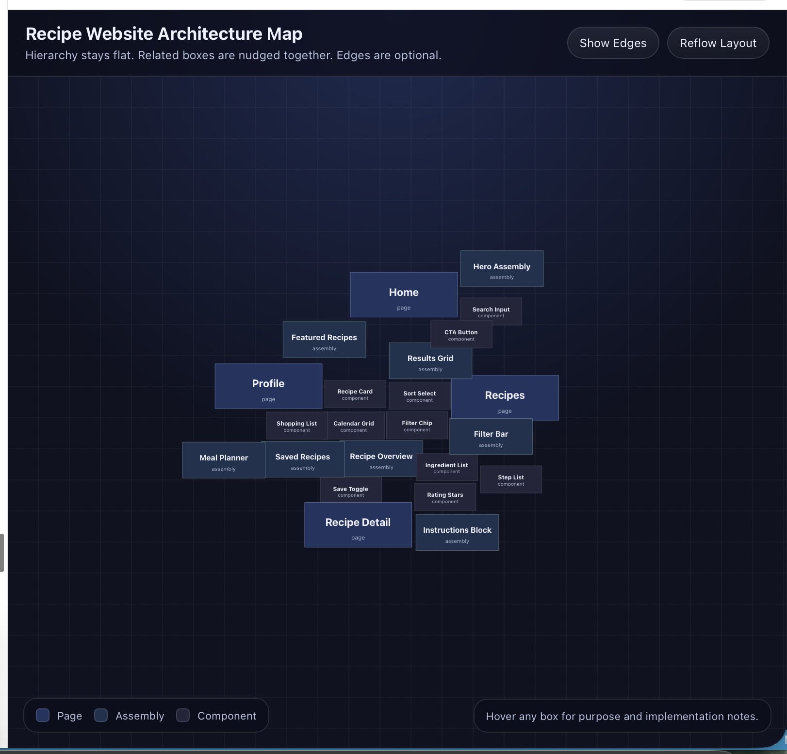

Hi,

A few things stand out, but nothing fatal. The concept reads well.

- What looks good
  - The size hierarchy is clear.
    - Pages read as primary.
    - Assemblies read as secondary.
    - Components read as tertiary.
  - The “flat boxes, no default edges” idea works.
    - It feels cleaner than a traditional node-link diagram.
    - The layout still hints at relationships through proximity.
  - The visual styling is cohesive.
    - Good contrast.
    - Good box sizing.
    - The depth scaling feels intuitive.
- What looks a bit off
  - Some ownership relationships feel ambiguous.
    - Results Grid sits between Home and Recipes, so it is not immediately obvious that it belongs to Recipes.
    - Recipe Overview visually feels closer to Saved Recipes than to Recipe Detail.
  - A few related boxes are close, but not clearly “touching.”
    - Since touching is part of the concept language, a viewer may expect stricter adjacency for primary parent-child relationships.
  - Cross-link gravity may be overpowering hierarchy in a few spots.
    - Reused components are pulling assemblies into mixed clusters.
    - That helps with reuse discovery, but weakens page-centered grouping.
  - The overall composition is a little center-heavy.
    - Most items are packed into one dense central blob.
    - The page nodes do not form very distinct territories.

So the main issue is not aesthetics. It is semantic readability:

- hierarchy is visible,
- but parentage is sometimes less clear than reuse proximity.

I would still call this a successful first pass.

PRD-style summary

Working title

Recipe Site Structural Map

Objective

Provide a compact visual map of a website’s information architecture and UI composition using flat rectangular boxes instead of a traditional edge-heavy diagram.

The visualization should help a viewer quickly understand:

- which pages exist,
- which assemblies belong to those pages,
- which components support those assemblies,
- where components are reused across multiple areas.

Users

- Product designers reviewing page structure.
- Frontend engineers discussing composition and reuse.
- Technical leads aligning on architecture.
- Stakeholders who need a readable high-level map without reading code.

Core concept

The diagram represents a hierarchy and a relationship graph at the same time.

- Hierarchy
  - Pages are top-level objects.
  - Assemblies are grouped beneath pages.
  - Components sit beneath assemblies.
- Links
  - Nodes may also have non-hierarchical links.
  - These indicate reuse, dependency, or shared behavior.
- Visual rule
  - Edges are not shown by default.
  - Relationships are primarily communicated through spatial proximity and contact.

Functional requirements

- Node model
  - Each node must have:
    - label,
    - type,
    - depth,
    - descriptive metadata.
  - Supported node types:
    - Page
    - Assembly
    - Component
- Sizing by depth
  - Node size decreases with depth.
  - Pages are largest.
  - Assemblies are medium.
  - Components are smallest.
- Layout behavior
  - Related nodes should be positioned as close as possible.
  - Parent-child relationships should strongly prefer direct adjacency.
  - Linked nodes should be attracted to one another even when no edge is shown.
  - Nodes should avoid overlapping.
  - The layout should preserve a generally readable hierarchy while still revealing reuse clusters.
- Edge visibility
  - Relationship edges exist in the model.
  - Edges are hidden by default.
  - A control allows edges to be toggled on for debugging or inspection.
- Hover details
  - Hovering a node reveals additional metadata.
  - Metadata includes:
    - purpose,
    - implementation notes,
    - node type,
    - depth.

Interaction requirements

- Default state
  - Clean diagram with labels visible and no edges shown.
- Hover
  - Reveal contextual details in a tooltip.
- Reflow
  - Allow the user to reshuffle or recompute layout.
- Edge toggle
  - Allow the user to inspect the underlying graph when needed.

Data model used in the prototype

The sample dataset models a recipe website.

- Pages
  - Home
  - Recipes
  - Recipe Detail
  - Profile
- Assemblies
  - Hero Assembly
  - Featured Recipes
  - Filter Bar
  - Results Grid
  - Recipe Overview
  - Instructions Block
  - Saved Recipes
  - Meal Planner
- Components
  - Search Input
  - CTA Button
  - Recipe Card
  - Filter Chip
  - Sort Select
  - Ingredient List
  - Step List
  - Rating Stars
  - Save Toggle
  - Calendar Grid
  - Shopping List

The dataset includes both:

- strict hierarchy links,
- cross-links representing reuse across pages and assemblies.

Visual design principles

Area Decision Reason
Shape Flat rounded rectangles Keeps the diagram calm and legible
Scale Smaller boxes at deeper levels Reinforces hierarchy without extra decoration
Color Type-based color family Helps distinguish pages, assemblies, and components
Labels Always visible Makes the map useful at a glance
Details Tooltip on hover Preserves simplicity while exposing depth on demand
Edges Hidden by default Prevents clutter and keeps focus on structure

Success criteria

The visualization is successful if a user can:

- identify the major pages in under a few seconds,
- understand which assemblies belong to which pages,
- notice component reuse without needing visible edges,
- inspect deeper detail through hover,
- optionally reveal the full graph for verification.

Known tradeoff

Because proximity is doing the work normally done by edges:

- reuse can sometimes compete with strict parent-child grouping,
- and some nodes may drift into visually ambiguous positions.

That tradeoff is acceptable for exploration, but the next refinement should bias primary hierarchy more strongly than secondary links.

My recommendation for the next iteration:

- strengthen parent-child attraction,
- weaken cross-link attraction slightly,
- and introduce subtle page “territories” so each page owns a more recognizable local cluster.
