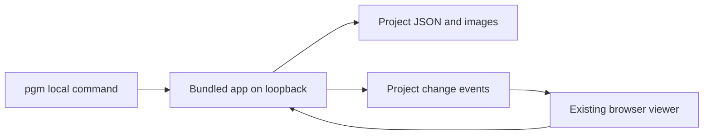

# PGM local viewer — shape brief

## Recommendation

Package the existing SolidStart app with `pgm`. Add a local command that starts the packaged app on loopback and opens the current viewer. Set `APP_DATA_DIR` to an explicit folder. Keep project reads, actions, API routes, image routes, and project events in that runtime.

The app already uses disk storage. The main change is how users install and start it. Replacing server actions with browser file access would create a much larger change and threaten viewer parity.

Use one local process as the writer for a folder. Local CLI commands call its existing `/api/v1` routes. This keeps the current mutation queue and event system effective. You confirmed that a managed local server meets your goal.

The hosted version must work as well as it does today. Keep its viewer, writes, images, events, production auth, deployment settings, and remote CLI behavior. Local startup is opt-in. Its folder ownership and credentials must not affect hosted requests.

## Problem and appetite

- **Problem:** Local projects require a separately running app service today.
- **Outcome:** An installed `pgm` package can open and edit projects stored on disk.
- **Appetite:** Reuse the current app and storage. Add startup, packaging, and target selection. No UI or storage rewrite.
- **Not in this shape:** Cloud sync, desktop shell, native single-file binary, direct external file editing, or an operating-system service.

## Core shape

Proposed commands, not existing commands:

```sh
pgm viewer --data-dir ./product-grid-data
pgm node list --local ./product-grid-data --project demo --json
```

The viewer command resolves the folder to an absolute path, starts the bundled runtime, waits for readiness, and opens a browser. It prints the URL and data path. It stays in the foreground. Ctrl+C stops the runtime but retains the files.



For the first usable slice, local CLI commands run while the viewer command owns the runtime. Later, a local CLI command can start a temporary runtime when no viewer is open. It must reuse an active runtime for that folder. It must stop only a runtime it owns. Keep remote credentials and the global current project separate from local selection.

The current storage layout remains authoritative:

```text
product-grid-data/
  projects/
    <project-id>/
      project.json
      images/<node-directory>/<image-file>
```

Choose local mode explicitly. Reject conflicting local and remote flags. Do not discover an arbitrary server on port 3000 or send local requests to the configured remote server.

## Current fit

- **Reuse:** `app/src/lib/projects/data.server.ts`, the record reader and serializer, archive support, and image storage.
- **Reuse:** `app/src/lib/projects/data.ts`, viewer components, `/api/projects`, `/api/v1`, and `/ws/jobs`.
- **Add:** A packaged app directory, a small TypeScript launcher, and local target resolution before `ProductGridClient` construction.
- **Collision:** Production API routes require a token. The launcher can generate a local token with existing scopes. No development-mode auth bypass is needed.
- **Collision:** The mutation queue and project events live in process memory. Separate direct disk writers would bypass both.
- **Collision:** Some reads normalize and rewrite records. Avoid pointing proof work at actual user data.

SolidStart v1 exposes Nitro deployment settings. Nitro documents standalone Node output and host/port configuration. Treat this as support for the approach, not proof that this app’s artifact is complete. Use the installed versions and a clean relocated artifact to prove it. [SolidStart configuration](https://docs.solidjs.com/solid-start/v1/reference/config/define-config), [Nitro Node runtime](https://nitro.build/deploy/runtimes/node).

## How to make this go better

- **Prove relocation first.** Start a fresh built artifact outside the checkout before adding launcher behavior. Missing assets should change the packaging approach early.
- **Keep one writer.** Route CLI and viewer writes through the same local process. This preserves mutation ordering and viewer events.
- **Ship one app build.** Include server output, browser assets, and required runtime dependencies together. Do not build a second viewer.
- **Make the folder explicit.** Pass an absolute `APP_DATA_DIR`. Keep package upgrades separate from user data.
- **Test production behavior locally.** Use production auth, app routes, image routes, and WebSocket updates against disposable files.
- **Protect hosted behavior.** Capture a normal production-mode baseline on disposable data. Repeat the same workflows after shared changes.

## First proof

- **Question:** Can the current production app operate from a relocated build without the source checkout?
- **Proof:** Build from current source. Copy the complete output to `tmp/`. Start it with an empty disposable `APP_DATA_DIR`, loopback host, and a local token.
- **Observe:** CLI project creation and node edits persist. App HTML and assets resolve. Image uploads and downloads preserve bytes. Restart restores the project.
- **Pass / fail:** Pass when the artifact works without checkout dependencies. Fail when it requires source paths, omitted assets, or a second persistence implementation.
- **Deliberately excludes:** New CLI flags, browser automation, publication, and real user data. Full visual and interaction parity remains a later manual proof.

## Rabbit holes and no-gos

- Do not add a database, generic storage adapter, Electron, or browser filesystem API for this scope.
- Do not rewrite the large project service to make packaging easier.
- Do not treat a static client bundle as the complete app; server actions and events must remain available.
- Do not add an always-running daemon before the foreground path works.
- Do not copy existing live data into a local mode automatically.
- Do not change hosted defaults to loopback-only binding or require local ownership records for hosted writes.

## Plan handoff

Follow the implementation plan. Prove relocation first, then a packaged foreground viewer, then CLI reuse and restart behavior. Keep command names, default folder location, and port selection provisional.

Each milestone also verifies normal hosted operation where it changes shared code or packaging. Completion requires both operating modes to retain the complete viewer.
